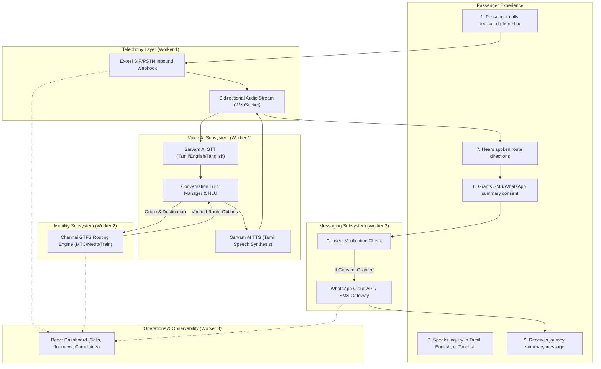

# Chennai Mobility AI — System Architecture & Workflow

Chennai Mobility AI is a telephone-first, multilingual conversational transit assistant designed specifically for commuters in the Chennai metropolitan region.

---

## 1. End-to-End Call Workflow

The system provides telephone callers with real-time transit directions through Tamil, English, and Tanglish spoken dialogues, followed by optional post-call summary messages.

---

## 2. Detailed Pipeline Steps

1. **Inbound Call Setup**:
   A commuter dials the published Chennai Mobility number from any standard mobile phone or basic feature phone (no smartphone app or internet connection needed on the caller side). Exotel hits `POST /telephony/inbound` and connects the call to `WS /telephony/audio/{call_id}`.

2. **Speech Ingestion & Code-Mixing Detection**:
   Incoming audio stream (8 kHz / 16 kHz) is piped to Sarvam AI STT. The conversational engine detects whether the caller speaks formal Tamil, Indian English, or colloquial Tanglish (e.g., *"Guindy-la irundhu Central poganum, enna bus irukku?"*).

3. **Dialogue Management & Slot Extraction**:
   The conversation orchestrator extracts the departure point, destination, preferred transit mode, and optional departure time constraints.

4. **Transit Route Determination**:
   The mobility engine checks the schedule and route database for:
   - Metropolitan Transport Corporation (MTC) Chennai city buses.
   - Chennai Metro Rail Limited (CMRL) Blue and Green lines.
   - Southern Railway Chennai Suburban EMU routes (Beach - Tambaram - Chengalpattu, Central - Arakkonam).
   - Feasible interchange/transfer points.

5. **Spoken Response Generation**:
   The route results are converted into a natural conversational Tamil script, synthesized into audio via Sarvam TTS, and streamed back to the telephony carrier with low latency.

6. **Post-Call Consent & Summary Delivery**:
   Before hanging up, the assistant asks: *"Would you like a summary of this route sent to your WhatsApp or SMS?"* If and only if the caller gives explicit consent, the message is queued and dispatched to `POST /api/messages/send`.

7. **Operational Governance & Dashboard**:
   All session metadata, latency metrics, passenger grievances/complaints, and system health status are monitored through the React + Vite administrative dashboard.

---

## 3. Implementation Status Matrix

| Component | Module Path | Current Baseline Status | Implementation Owner |
| :--- | :--- | :--- | :--- |
| **FastAPI Core Application** | `backend/app/main.py` | **Implemented & Verified** | Integration Lead |
| **Central Configuration** | `backend/app/config.py` | **Implemented & Verified** | Integration Lead |
| **Database Session Foundation** | `backend/app/database/` | **Implemented (PG ready, SQLite dev fallback)** | Integration Lead |
| **Shared Pydantic Schemas** | `backend/app/schemas/` | **Implemented & Tested** | Integration Lead |
| **Health Check Endpoint** | `GET /health` | **Implemented & Tested (HTTP 200)** | Integration Lead |
| **Standardized Error Handling**| `backend/app/core/errors.py`| **Implemented & Tested** | Integration Lead |
| **Structured Logging** | `backend/app/core/logging.py`| **Implemented & Tested** | Integration Lead |
| **React + Vite Dashboard Shell**| `frontend/` | **Implemented, Built & Verified** | Integration Lead |
| **Backend Health Indicator** | `frontend/src/components/HealthBadge.tsx` | **Implemented & Connected** | Integration Lead |
| **Integration Transparency UI** | `frontend/src/components/IntegrationNotice.tsx` | **Implemented & Connected** | Integration Lead |
| **Exotel Telephony Inbound & WS**| `backend/app/telephony/` | Planned (Contract & skeleton ready) | Worker 1 (`worker/voice-telephony`) |
| **Sarvam AI STT & TTS Pipeline** | `backend/app/voice/` | Planned (Contract & interface ready) | Worker 1 (`worker/voice-telephony`) |
| **Dialogue & Turn Orchestration**| `backend/app/conversation/` | Planned (Interface ready) | Worker 1 (`worker/voice-telephony`) |
| **Chennai GTFS Ingestion** | `backend/app/mobility/` | Planned (Interface & fixtures ready) | Worker 2 (`worker/mobility-backend`) |
| **Route & Transfer Engine** | `backend/app/mobility/` | Planned (Interface ready) | Worker 2 (`worker/mobility-backend`) |
| **WhatsApp Cloud API Dispatch** | `backend/app/messaging/` | Planned (Interface ready) | Worker 3 (`worker/frontend-messaging`) |
| **SMS Gateway Dispatch** | `backend/app/messaging/` | Planned (Interface ready) | Worker 3 (`worker/frontend-messaging`) |
| **Complaint Logging Service** | `backend/app/complaints/` | Planned (Interface ready) | Worker 3 (`worker/frontend-messaging`) |
| **Browser Voice Testing Tool** | `frontend/` | Planned | Worker 3 (`worker/frontend-messaging`) |

